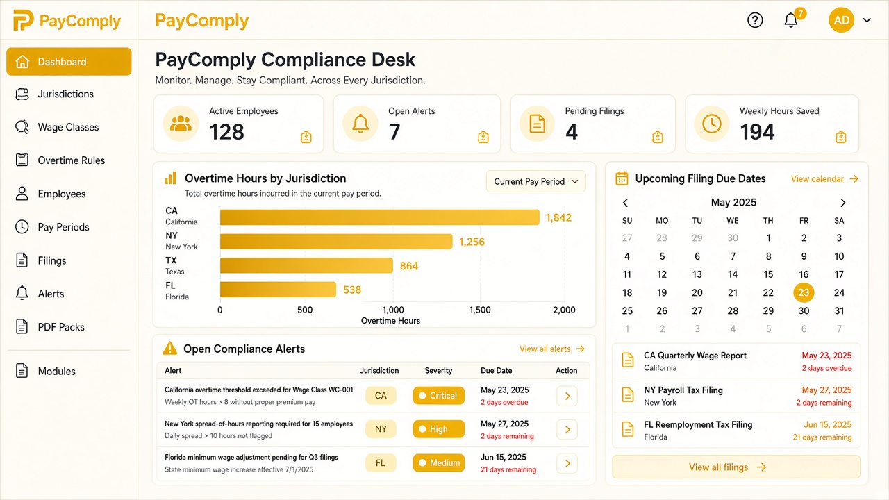

# AI Customer Support Vertical Agent



**SEO title:** AI Customer Support Vertical Agent — Ticket Triage, Knowledge Answers & CSAT Automation  
**SEO description:** Vertical AI customer support agent for ticket triage, knowledge answers, escalation routing, and CSAT-improving automation tailored by industry.

**Keywords:** AI customer support agent, ticket triage, knowledge base answers, escalation routing, CSAT automation, support macros, vertical support AI, Laravel Filament helpdesk

---

## Why this product

Generic helpdesks treat every industry the same and leave agents hunting for answers while CSAT slips. **AI Customer Support Vertical Agent (SupportPilot AI)** delivers industry-tuned ticket triage, knowledge answers, escalation routing, macros, and CSAT recovery — with modular toggles so SaaS, retail, fintech, and clinic teams enable only what they need.

### Business ROI / time saver

| Pain today | With SupportPilot AI |
|---|---|
| Agents re-read every ticket from scratch | AI triage scores intent, priority, and confidence |
| Knowledge scattered across Notion & Slack | Vertical knowledge packs with AI answer drafts |
| Escalations depend on tribal knowledge | Rule-based routing to queues and on-call roles |
| CSAT reviewed too late | Post-resolution surveys + recovery flags |
| Buying tools you do not need | Modular toggles — turn modules on/off per business |

**Demo model:** reclaim **~170+ hours/week** across enabled modules at a blended support-ops rate, with ROI surfaced on the public pricing page and admin widgets.

---

## Stack

- PHP Laravel (latest stable) + Filament admin (`#2563EB` blue accent)
- Modular feature flags (modules on/off; core support modules protected)
- Multi-role users: Super Admin, Admin, Manager, Staff/Agent, Client/Customer, Demo
- Public marketing pages for features, modules, knowledge, triage, pricing, demo + customer portal
- Packagist packages from [imrandevbd](https://packagist.org/packages/imrandevbd/)

### Required packages

- `imrandevbd/drutogoti` — speed layer
- `imrandevbd/laravel-admin-panel` — admin panel foundations
- `imrandevbd/laravel-ai-catalog` — knowledge catalog scrape assist
- `imrandevbd/laravel-ai-hub` — AI answer assist wiring
- `imrandevbd/laravel-attendance-hub` — agent attendance bridge
- `imrandevbd/laravel-unicode-pdf` — multilingual CSAT / ticket PDF packs
- `imrandevbd/laravel-universal-slug` — Unicode-safe slugs for articles & macros

**Laravel 13 note:** `drutogoti`, `laravel-admin-panel`, and `laravel-attendance-hub` ship as path shims under `packages/*` that require `illuminate/support` `^11|^12|^13` so Composer resolves cleanly while all seven packages remain declared in `composer.json`.

---

## Modules (toggle on/off)

| Key | Module | Category | Core |
|---|---|---|---|
| `ticket_triage` | Ticket Triage | operations | Yes |
| `knowledge_base` | Knowledge Answers | knowledge | Yes |
| `escalation_routing` | Escalation Routing | operations | Yes |
| `csat_surveys` | CSAT Surveys | quality | Yes |
| `macros` | Support Macros | productivity | Yes |
| `industry_profiles` | Industry Verticals | vertical | No |
| `ai_answers` | AI Answer Assist | ai | No |
| `pdf_exports` | Unicode PDF Exports | reporting | No |
| `catalog_scrape` | Knowledge Catalog Scraper | data | No (off by default) |
| `attendance_ops` | Agent Attendance | workforce | No (off by default) |
| `speed_optimizer` | Drutogoti Speed Layer | platform | No |

---

## Domain features

- **Ticket triage** — intent detection, priority scoring, AI confidence, tags
- **Knowledge answers** — industry articles with helpful votes and public status
- **Escalation routing** — intent + priority + AI threshold rules to queues
- **CSAT surveys** — score capture, recovery flags, channel tracking
- **Macros** — shortcuts with `{{variables}}` for consistent replies
- **Industry verticals** — SLA, tone, deflection targets per sector
- **AI answer suggestions** — draft replies linked to knowledge articles via AI hub
- **Module toggles** — Filament module matrix + env defaults
- **Multi-role Filament admin** — blue `#2563EB` SupportPilot dashboard

---

## Demo users

Password for all accounts: value of DEMO_PASSWORD in .env (default password).

| Role | Email |
|---|---|
| Super Admin | admin@supportpilot.test |
| Admin | ops-admin@supportpilot.test |
| Manager | manager@supportpilot.test |
| Agent | agent@supportpilot.test |
| Customer | client@supportpilot.test |
| Demo | demo@supportpilot.test |

---|---|---|
| Demo | demo@supportpilot.test | password |
| Super Admin | superadmin@supportpilot.test | password |
| Admin | admin@supportpilot.test | password |
| Manager | manager@supportpilot.test | password |
| Agent | agent@supportpilot.test | password |
| Customer | customer@supportpilot.test | password |

Admin panel: `/admin` · Marketing: `/` · Portal: `/portal`

---

## Quick start

```bash
composer install
cp .env.example .env
php artisan key:generate
touch database/database.sqlite
php artisan migrate --seed
php artisan serve
```

### Docker

```bash
docker compose up -d --build
```

App nginx on `http://localhost:8080` (MySQL published on `3310`).

---

## Author

**Imran Ahmed** · [me@imrandev.bd](mailto:me@imrandev.bd) · [https://imrandev.bd](https://imrandev.bd)

---

## 🤝 Let's Connect & Collaborate

I am open to Senior Remote Full-Stack Roles, AI Platform Architecture Contracts, and Enterprise Technical Advisory.

Timezone: UTC+6 (Dhaka / Rangpur, Bangladesh) — Flexible overlap with US, UK, and European business hours.

Delivery Mode: Async-ready, Slack, Discord, Jira, GitHub, and production-first accountability.

| Channel | Address / Handle | Quick Action |
|---|---|---|
| 🌐 Primary Portfolio | [imrandev.bd](https://imrandev.bd) | [Visit Site ↗](https://imrandev.bd) |
| 📦 Packagist Packages | [packagist.org/packages/imrandevbd/](https://packagist.org/packages/imrandevbd/) | [View Packages ↗](https://packagist.org/packages/imrandevbd/) |
| 💼 LinkedIn Profile | [linkedin.com/in/imranbru99](https://linkedin.com/in/imranbru99) | [Connect ↗](https://linkedin.com/in/imranbru99) |
| 🐙 GitHub Profile | [github.com/imranbru99](https://github.com/imranbru99) | [Follow ↗](https://github.com/imranbru99) |
| 💬 WhatsApp Direct | +880 1576-918420 | [Chat Now ↗](https://wa.me/8801576918420) |
| 📧 Direct Email | me@imrandev.bd | [Send Email ↗](mailto:me@imrandev.bd) |
| 🐦 X (Twitter) | [@imrandev_bd](https://x.com/imrandev_bd) | [Follow ↗](https://x.com/imrandev_bd) |
| 📺 YouTube Tech | [@ImranDevBD](https://youtube.com/@ImranDevBD) | [Subscribe ↗](https://youtube.com/@ImranDevBD) |
